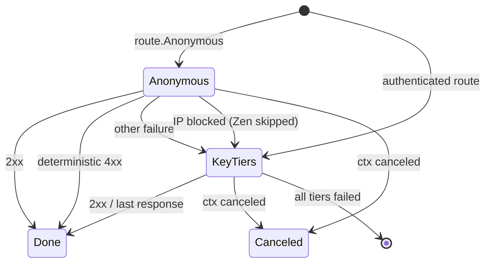
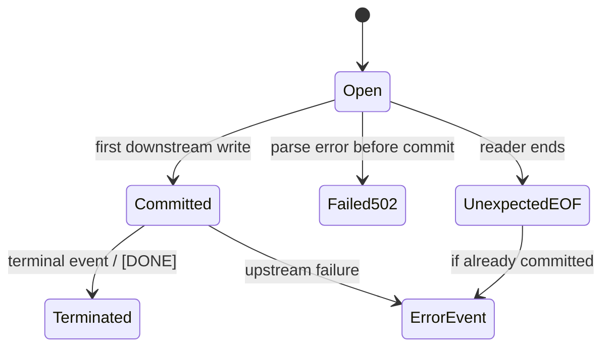
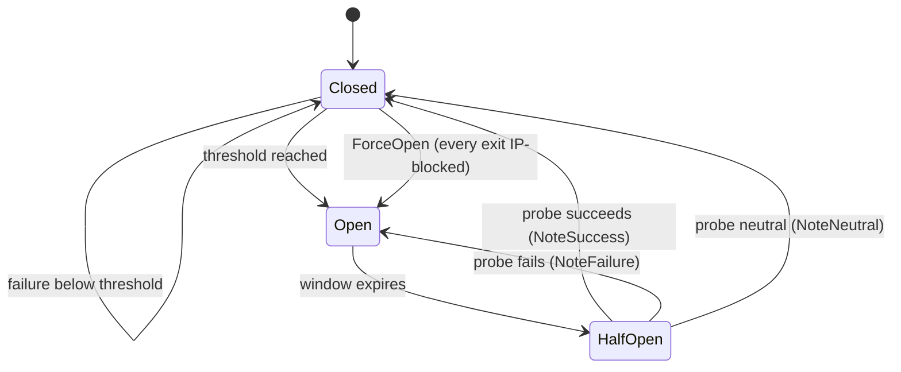
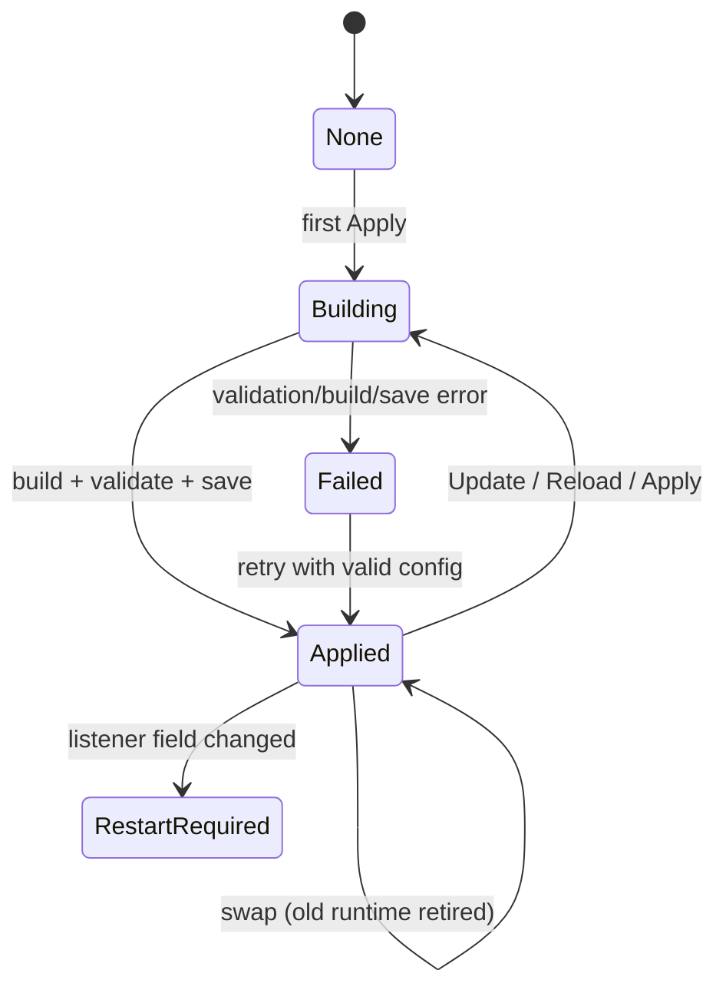

# State machines

This gateway is built from a handful of long-lived state machines and a few
per-request ones. Most of them are **implicit**: the state lives in booleans,
atomics, counters, maps and timestamps, and the legal transitions are enforced
by scattered `if` statements. They work, but the vocabulary was only in the
heads of the people who wrote them.

This document is the shared map. It is the source of truth for three audiences:

- **Operators (UX):** every state that can make a request fail is named here and
  surfaced in `/health`, `/api/monitor` or `/api/models/availability`.
- **Developers (DX):** every transition has one owner, one invariant and a test.
- **Agents (AX):** the same state names appear in the docs, the JSON and the Go
  constants, so a change can be reasoned about without re-reading the whole
  request path.

## Convention

1. **Stored state is the minimum.** A field exists only if a transition must
   remember something (a deadline, a counter, a generation). Everything else is
   **derived on read** by a small function next to the owner.
2. **Derived state is never persisted.** It cannot go stale, and adding it to a
   JSON response is additive and safe.
3. **One owner per machine.** The type that holds the state owns the transition
   methods. Callers do not write the fields directly.
4. **Every transition is guarded.** A transition that a caller can skip must be
   paired with a release (`defer ReleaseProbe()`), or the machine can wedge.
5. **Names are shared.** The strings below are used in Go constants, JSON and
   the WebUI. Do not invent synonyms (`cooling` vs `cooldown`, `paused` vs
   `open`).
6. **A new machine needs a test.** `internal/*/state_test.go` and
   `internal/*/*_test.go` pin the legal transitions and the derived labels.

## Vocabulary

| Machine | States | Visible in |
| --- | --- | --- |
| Anonymous lane breaker | `closed`, `open`, `half-open` | `/health` → `anonymous_lane` |
| Key node | `ready`, `cooling` | `/api/monitor` → `resources.keys[].state` |
| Proxy route | `healthy`, `unhealthy`, `checking`, `blocked` | `/api/monitor` → `resources.proxies[].state` |
| Free model availability | `unknown`, `available`, `manual`, `disabled` | `/api/models/availability` → `models[].status` |
| Model catalog | `pending`, `empty`, `stale`, `ready` | `/health` → `models.status` |
| WARP pool | `unavailable`, `ready` | `/health` → `warp.status` |
| Rotation group | `current`, `paused`, `available` | `/api/rotation` |
| Config runtime | `none`, `applying`, `applied`, `restart-required`, `failed` | `/api/config`, apply result |
| Admin session | `anonymous`, `authenticated`, `expired` | `/api/auth/session` |
| OAuth credential | `valid`, `expiring`, `refreshing`, `failed`, `needs-login` | `/health` issues, `/api/go/auth` |
| Stream | `open`, `committed`, `terminated`, `error` | logs, stream error events |

## Request path

These machines live for one request. They are the ones that decide whether a
client gets a 200, a 4xx, a 503, or a truncated stream.

### R1. Lane selection — `doUpstreamTiers`

Owner: `internal/gateway/upstream.go`.

Invariants:

- A deterministic request rejection (`errDeterministicClientRejection`,
  `isDeterministicClientResponse`) is returned as-is and **never retried** on
  another lane or key.
- A free-tier IP block (`errFreeTierIPBlocked`) skips the Zen key tier but keeps
  the authenticated Go tier.
- A canceled context ends the walk and must not cool a key or proxy it never
  really tried.
- The last response is buffered (`bufferRetryResponse`) and closed
  (`replaceRetryResponse`) exactly once, so a retry can reuse the connection.

### R2. Key attempt loop — `doKeyUpstream`

Owner: `internal/gateway/upstream.go`.

States: `next node → attempt → classify → (success | cool | neutral) → next`.
The attempt limit is `retry.max_attempts`, except a relay-pinned diagnostic gets
exactly one attempt. Each outcome updates the key node (`MarkSuccess` /
`MarkFailure`) and the proxy (`syncProxyResult`). Invariants:

- The cursor never returns the same node twice in one request.
- A pinned relay or debug key is single-shot and never mutates cooldowns.
- Attempt counters on the telemetry meta are set **before** the send.

### R3. Rotation walk — `rotationAttempt`

Owner: `internal/gateway/rotation.go`.

States: `attempt n → success | quota | failure | committed`. A committed reply
stops the walk: once bytes reached the client, another model cannot be tried.
A quota or rate-limit failure pauses the model in the group; three failures
pause it for 15 s. The group generation in the selection token prevents a late
request from switching away from a model the operator just selected.

Invariant: **never switch models after `committed`**. This is the boundary
between "retry is free" and "retry would duplicate output".

### R4. Stream lifecycle — `ForwardStream` / `TranscodeStream`

Owner: `internal/protocol/stream.go`.

Invariants:

- A malformed first frame becomes a JSON `502`; a malformed later frame becomes
  an in-band SSE error event (`emitUnexpectedStreamError`).
- A canceled client gets **no** synthetic error event.
- Chat ends with `data: [DONE]`; Anthropic and Responses never carry it.
- Every written event is flushed (`emitter.flush.Flush()`).

### R5. First-event timer — `doInferenceAttempt`

Owner: `internal/gateway/first_event.go`.

States: `waiting headers → streaming (committed) → timer disabled`. The timer
cuts only a 2xx `text/event-stream` response whose body has not produced its
first byte. Once a byte is committed, the timer can no longer kill the stream.

## Service health

These machines outlive requests and are shared by every runtime that the
controller builds.

### S1. Anonymous lane breaker — `anonymousNodes`

Owner: `internal/gateway/pool.go`. Classic closed / open / half-open breaker.

Invariants:

- Exactly one half-open probe: `AllowAttempt` uses `probing.CompareAndSwap`.
- Every `AllowAttempt` winner must release through `NoteSuccess`,
  `NoteFailure`, `NoteNeutral` or `ReleaseProbe`; callers use
  `defer ReleaseProbe()`.
- The window doubles per trip (`trip`) up to `backoff.max`.
- A disabled breaker (`threshold < 1`) is always closed.

Exposed as `/health.anonymous_lane`: `{enabled, state, pause_until, strikes,
consecutive_failures}`. When it is open, `issues` includes
`anonymous_lane_paused`, so an operator can tell a paused lane from a bad key.

### S2. Key node — `upstreamNode`

Owner: `internal/gateway/pool.go`.

States: `ready` ⇄ `cooling`. `cooldownUntil` is the only stored state; `state`
is derived. Transitions:

- `MarkFailure` on 401/403/429/5xx or transport error → `cooling`, exponential
  backoff from `performance.failure_cooldown_seconds`, extended by
  `Retry-After`.
- `MarkSuccess` → `ready`, failures reset.
- `RestoreProxy` → clears cooldown for keys whose preferred proxy recovered.

Invariant: a key's proxy binding changes atomically (`proxyIndex`), and
`bindingCount` is updated under `bindingsMu`.

### S3. Proxy route — `proxyTransport`

Owner: `internal/gateway/pool.go`.

States: `healthy`, `unhealthy`, `checking`, `blocked`. `blocked` is orthogonal
to health: the free tier flagged the egress IP, so the anonymous cursor skips
the exit even while it answers key traffic.

- `syncProxyResult`: any HTTP response → healthy; proxy-route failure →
  unhealthy.
- `CheckHealth`: only unhealthy proxies are checked; `checking` is a CAS claim.
- `markBlocked`: set by the free tier's abuse block; expires by deadline.

### S4. Anonymous exit cooldown — `anonymousNode`

Owner: `internal/gateway/pool.go`.

`failures` + `cooldownUntil` per exit. Backoff doubles up to 8×; `Retry-After`
is honoured up to the same ceiling. `#pool` transports are never cooled. A
blocked exit is skipped by the cursor until the block expires.

### S5. WARP pool — `warp.Pool`

Owner: `internal/warp/pool.go`.

States: `active`, `standby`, `cooling` (per exit), plus a pool-level
`unavailable`/`ready` in health. A registration failure cools the subnet; a
rejected egress is moved to `cooling` and retried after `egressCooldown`.

### S6. OAuth credential — `oauth.Connection`

Owner: `internal/oauth/client.go`, `internal/gateway/oauth_refresh.go`.

States: `valid` → `expiring` (< 5 min) → `refreshing` → `valid` | `failed`
(retry after 15 s) | `needs-login` (invalid_grant, expired, SSO). The refresh
slot (`oauthRefresh`) is a single-flight: one goroutine, `done` channel, `err`
and `retryAt`. `ResolveOAuth` loops until the credential is usable or the
context ends.

Invariants: only one refresh per tier at a time; a failed refresh is not
retried before `retryAt`; a credential whose organization changed requires a
new login.

### S7. Rotation group — `rotation.Group`

Owner: `internal/rotation/state.go`.

States per model: `current`, `paused(until)`, `available`. Per group:
`generation` bumps on `Current`, `Order` or `Alias` changes. A request's
`Token` carries the generation; `Fail` only switches while that generation is
still current, so a late request cannot undo an operator selection.

### S8. Free model availability — `models.Availability`

Owner: `internal/models/availability.go`.

States: `unknown` (never probed), `available`, `manual` (operator-held, not
probed), `disabled` (probe failed, 24 h recheck). `Status()` derives the label;
`/api/models/availability` adds it as `status`.

Invariants: `Generation` drops probe results that started before a manual
switch; `ProbeVersion` migrates legacy records; a manual model is never
auto-disabled.

### S9. Model catalog — `models.ModelCatalog`

Owner: `internal/models/catalog.go`, `internal/models/cache.go`.

States: `none` → `disk` (stale) → `live` (fresh), plus per-tier `pending` and
`oauth`. `ReplaceWithCapabilities` marks fresh; `LoadCache` marks stale until
the next refresh. Health maps this to `pending`, `empty`, `stale`, `ready`.

Invariant: a cache is validated on load (schema version, timestamp, known tiers
and protocols) and written atomically with mode `0600`.

### S10. Pricing metadata — `models.PricingRegistry`

Owner: `internal/models/pricing.go`.

States: `empty` → `ready`, with `stale` and `last_error` as freshness flags.
The cache file is the fallback when the metadata endpoint is unreachable.

## Control plane

### C1. Config runtime — `RuntimeController`

Owner: `internal/gateway/runtime.go`.

`updateMu` serializes all writers; `current` is an atomic pointer. The order is
fixed: hash password → normalize → build → copy catalog state → validate
rotation → persist → swap → start new loops → cancel old loops. The new runtime
is started **before** the swap so the first request never sees a cold catalog.

Invariants: a failed build/save closes the new WARP pool and cancels the new
loops; the old runtime keeps serving until the swap; retired WARP pools close
after a grace period.

### C2. Admin session — `adminSession`

Owner: `internal/admin/auth.go`.

States: `anonymous` → `authenticated` → `expired`/`revoked`. A session is valid
only while it is unexpired **and** its password fingerprint matches the current
config, so changing the password revokes every session. The earliest-expiring
session is evicted at the cap.

### C3. Server key — `config.ServerKeys`

States: `enabled`, `disabled`, `removed`. Metadata is keyed by fingerprint;
`FirstEnabledServerKey` must never return empty (the config refuses to start).

### C4. WebUI OAuth attempt — `admin.oauth`

States: `started` → `polling` → `authorized` | `expired` | `cancelled`. The
attempt map is keyed by state and session; a poll is valid only while the
attempt pointer matches and the session is still valid.

### C5. Telemetry stream counter — `telemetry.Metrics`

States: `in-flight` (BeginStream/EndStream) and `idle`. Every stream must be
paired; a panic-safe `defer` is the guard.

## Protocol internals

### P1. SSE reader — `readSSE`

States: `open` → `record complete` → `open`, and `truncated` at EOF. Comments
are skipped; `event:` and `data:` lines accumulate; a blank line flushes. A
final unterminated record is `errSSEUnexpectedEOF`, never a complete event.

### P2. Bridge stream parser — `bridgeStreamParser`

Per stream: `started` (response ID seen), `tools[key]` (announced/started),
`toolNames` (fragmented Chat name), `responseArgs`/`responseReasoning` (seen).
A tool starts once its name and first argument are known, or at
`finish_reason`.

### P3. Bridge stream encoder — `bridgeStreamEncoder`

Per response: `started`, `done`; per block: `textOpen`, `reasoningOpen`,
`reasoningClosed`; per tool: `Started` and `EmittedArguments`. Blocks are
sequential for Anthropic/Responses, so text closes reasoning and vice versa
before a new block opens.

### P4. Text tool scanner — `textToolScanner`

States: `idle` → `held` (trailing fragment may become an opener) → `open`
(inside a `<tool_call>` block) → `idle`. `final` flushes a held fragment as
text; a block over `textToolBufferLimit` is released instead of buffered
forever.

### P5. Tool rename stream — `streamToolRenameState`

States: `undecided` → `pending` (name is a prefix of a known wire name) →
`decided`. Arguments are held while undecided and released with the name, so a
split tool name never loses its arguments. `finish()` flushes pending calls
before `[DONE]`.

### P6. Collapse accumulator — `collapseAccumulator`

State: `reason` points at the open reasoning block. Encrypted reasoning splits
the block and closes it immediately; a signature appends to the open block.

## Invariants worth a regression test

1. A deterministic 4xx is never retried.
2. A canceled context never cools a key or proxy.
3. A committed stream is never retried or replayed.
4. A half-open breaker hands out exactly one probe and always gets it back.
5. A cooling key reports `cooling` while `cooldown_until` is in the future.
6. A blocked proxy reports `blocked` even while healthy.
7. A manual availability record is never auto-disabled.
8. Config save failure leaves the old runtime serving.
9. A tool name split across Chat frames is reassembled with its arguments.
10. Chat streams end with exactly one `[DONE]`.

## Peripheral state

Smaller caches and counters that are state machines in the weak sense (one
transition or one expiry rule), listed so they are not mistaken for missing:

| State | Owner | Rule |
| --- | --- | --- |
| Quota cache entry | `internal/admin/model_quotas.go` | success 1 min, failure 15 s, then `expired` → refetch |
| Log ring | `internal/telemetry/logging.go` | bounded buffer; oldest event dropped |
| Usage windows | `internal/telemetry/metrics.go` | lifetime and rolling hour; reset on process start |
| Redactor | `internal/config/secrets.go` | replacement set rebuilt on config apply |
| WebUI preferences | `webui/js` | language/theme in browser storage; no server state |

## Where to look

| Concern | File |
| --- | --- |
| Lane fallback, attempts | `internal/gateway/upstream.go` |
| Key/proxy/breaker state | `internal/gateway/pool.go` |
| Health + derived states | `internal/gateway/health.go` |
| Runtime swap | `internal/gateway/runtime.go` |
| Rotation | `internal/gateway/rotation.go`, `internal/rotation/state.go` |
| Streaming | `internal/protocol/stream.go`, `stream_parser.go`, `stream_emitter.go` |
| Text tool calls | `internal/protocol/xmltool.go` |
| Availability/catalog | `internal/models/availability.go`, `catalog.go`, `cache.go` |
| Sessions/keys | `internal/admin/auth.go`, `internal/admin/api_keys.go` |

## Follow-ups

These machines are still stored implicitly and are candidates for the same
treatment when they next change:

- The upstream tier walk (`doUpstreamTiers`) could become a typed
  `laneState` instead of the `blocked`/`lastResponse` locals.
- Rotation attempts use string outcomes (`success`, `quota_or_rate_limit`, …);
  they should become constants shared with the WebUI.
- The WebUI derives `cooling`/`available` from timestamps in JS; it should read
  `keys[].state` and `proxies[].state` instead.
